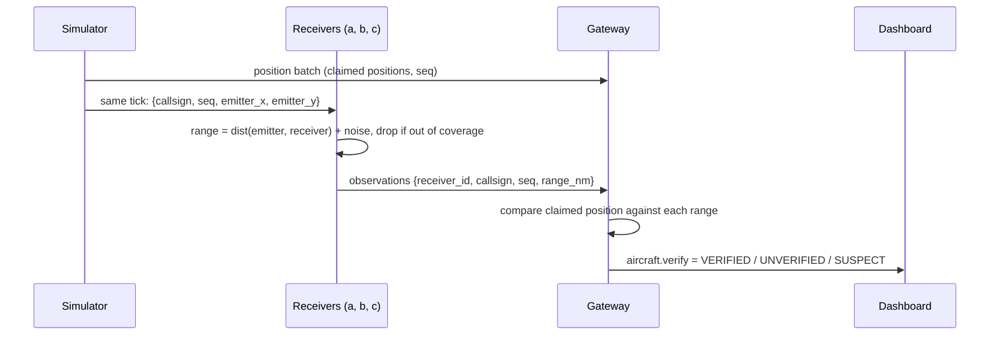

# Collins: Interface and Security Design

Scope from the proposal: API gateway, radar dashboard, controller
authentication and authorization, mutual TLS, ground receivers and the
"ghost aircraft" validation, and the sector Ready flag with the standby buffer.

This document describes how each piece fits into the code that already exists
(Sufiya's scaffold, commit `d3ae8e9`) and what changes in which file. Read `docs/how-it-works.md` first; this builds on it.

---

## 1. What exists today (the parts I build on)

| Piece | Where | Relevant detail |
|---|---|---|
| Gateway | `cmd/gateway/main.go` | HTTP on :8080. `POST /api/positions` (batch from sim), `GET /api/state`, `GET /ws` (dashboard feed). Polls every node's `/status` every 500 ms, caches the registry's ownership table in `g.owners`. |
| Per-callsign lock | `g.inflight` in the gateway | A callsign with a claim/handoff queued or running is marked in-flight, so the gateway never runs two ownership changes for one aircraft at once. I reuse this for clearances (section 4). |
| Node | `cmd/node/main.go` | HTTP on :8080: `/status`, `/apply` (leader only, returns 421 + `leader_id` otherwise), `/track`, `/owners`, `/metrics`. Raft on :7000. |
| FSM | `internal/fsm/fsm.go` | `set`/`delete` key/value plus ownership ops. Clearances can be stored with `set` and no FSM change. |
| Sector map | `defaultSectors()` / `geoSector()` | Static four quadrants of a 200 x 200 NM airspace, tower = 15 NM circle at (100,100) below 10,000 ft. Issaq will move this into the registry. |
| Receivers | `sim/receiver.py` + 3 containers | Placeholder at (20,20), (180,40), (100,190) NM. Prints and sleeps. |
| Dashboard | `dashboard/src/App.jsx` | Canvas radar, cluster table, handoff counters. nginx proxies `/api/` and `/ws` to the gateway. A `TODO` marks where alerts go. |
| Proto | `proto/atc.proto` | Draft only, not compiled. Does not yet match the real flows (no `claim`, no `accept`, no status call). |

Everything between components is currently plain HTTP/JSON with no
authentication. Anyone on the Docker network can call `/apply` on a leader.

---

## 2. Goals and non-goals

**Goals**

1. Only an authenticated controller can issue a clearance, and only for an
   aircraft that their sector currently owns (authorization tied to the
   registry's mutual exclusion).
2. Only the gateway can write to a node (`/apply`, `/track`); a rogue
   container on the network is rejected. This is the mTLS demo.
3. Spoofed ("ghost") aircraft are detected by cross-checking the position an
   aircraft claims against independent ground-receiver measurements, and are
   flagged on the radar and blocked from receiving clearances.
4. When a sector cluster has no leader (election in progress, lost majority),
   the gateway does not fail requests to it; it holds them in a per-sector
   buffer and flushes when the sector is Ready again.
5. Move the gateway-to-node and simulator-to-gateway links to gRPC, as the
   proposal promises, without breaking the system while doing it.

**Non-goals (stated in the report as simplifications)**

- TLS on Raft peer-to-peer traffic (port 7000). hashicorp/raft supports a
  custom stream layer, but it is not needed to make the point.
- Real time-difference-of-arrival multilateration. Receivers report ranges
  instead (section 6 explains why).
- Multiple gateways. The design assumes one gateway; section 4 notes where
  that matters.
- Production-grade identity (OAuth, SSO). A users file plus JWTs is enough.

---

## 3. Sector Ready flag and standby buffer

### Definition

A sector is **Ready** when, on the gateway's latest poll:

- exactly one of its nodes reports `State == "Leader"`, and
- that poll is less than 1.5 s old (three poll intervals).

Otherwise it is **NotReady**. The gateway already has this information in
`g.nodes`; the flag is a small function over it, recomputed in `pollLoop()`.

```go
type readiness struct {
    Ready     bool      `json:"ready"`
    Leader    string    `json:"leader"`
    Since     time.Time `json:"since"`     // when it last changed
    Buffered  int       `json:"buffered"`  // items waiting in the buffer
}
// g.ready map[string]readiness, guarded by g.mu
```

### What gets buffered, and what does not

| Traffic | When the sector is NotReady | Why |
|---|---|---|
| Position reports (`/track`) | Unchanged: still B-multicast to whichever replicas are up. | Positions do not go through Raft, followers accept them, and the next report replaces a lost one. Buffering them adds nothing. |
| Clearances | Held in a per-sector FIFO buffer, max 64 entries, 10 s TTL each. Client gets `202 Accepted` with `status: "pending"`. Flushed in order when the sector becomes Ready. Expired ones are reported back as `expired`. | A clearance is a Raft write and needs a leader. Losing it silently is the failure we are guarding against; holding it forever is also wrong, so it has a TTL. |
| Handoffs **into** the sector | The gateway skips `begin` and leaves the aircraft with its source until the target is Ready. | Today the gateway runs `begin`, fails at `accept`, and `abort`s on every report. Checking Ready first removes that churn and shrinks the abort counter to real races. |
| Handoffs **out of** the sector | Unchanged. `begin`/`commit` go to the registry, not the source. | The source sector is not written to during a handoff. |

The buffer is the "in-memory map per sector" from the proposal's
technology table: `map[string][]pendingClearance` inside the gateway, no new
container.

### Hook for Issaq

Before the standby cluster takes half of a split sector, Issaq's split logic
should check `g.ready["standby"].Ready`. A split into a NotReady cluster is
refused and retried. This is the "standby buffer" box in the diagram.

### Demo

`scripts/chaos.sh kill-leader sector-2`, then issue a clearance to an aircraft
in sector-2 from the dashboard. It shows as pending, then commits once a new
leader is elected (typically within one to two seconds). The dashboard's
cluster table shows the Ready flag going red and back.

---

## 4. Clearances (the write path that auth protects)

The proposal centres on Raft-committed clearances, but there is no clearance
endpoint yet. I add one, because authentication has nothing to protect
without it.

### Endpoint

```
POST /api/clearance            (requires a controller JWT)
{ "callsign": "ATC042", "instruction": "DESCEND FL250" }

200 { "status": "committed", "sector": "sector-3", "index": 1187 }
202 { "status": "pending",   "sector": "sector-3" }      // sector NotReady
403 { "error": "ATC042 is owned by sector-1, not your sector" }
409 { "error": "ATC042 is TRANSFERRING, clearances frozen" }
409 { "error": "ATC042 failed position verification" }
```

### Steps inside the gateway

1. Verify the JWT (section 5). Role must be `controller` or `supervisor`.
2. Take the per-callsign lock: if `g.inflight[callsign]` is set, return 409
   ("handoff in progress, retry"). Otherwise set it for the duration of the
   request. This stops a handoff from starting between the ownership check
   and the commit.
3. Read the owner **from the registry leader**, not from the cache. The
   cache can be up to 500 ms stale.
4. Reject if status is `TRANSFERRING` (frozen during a transfer), if the
   owner is not in the token's `sectors` list (unless supervisor), or if the
   aircraft's verification state is `SUSPECT` (section 6).
5. If the owner sector is NotReady, put the clearance in the buffer and
   return 202.
6. Otherwise send to the owner sector's leader:
   ```json
   { "op": "set",
     "key": "clearance/ATC042/<uuid>",
     "value": { "callsign": "ATC042", "instruction": "DESCEND FL250",
                "issued_by": "ctrl-sector3", "sector": "sector-3",
                "issued_at_ms": 1762100000000 } }
   ```
   The Raft log index returned is the clearance's place in the total order.
7. Release the lock and push the result to the dashboard.

**Why step 2 is enough:** the gateway is the only handoff coordinator, and
it already serializes ownership changes per callsign through `inflight`. If
clearances take the same lock, a handoff and a clearance for the same
aircraft can never overlap. This would not hold with several gateways; the
report should say so.

Storing clearances with the existing `set` op means no FSM change. If the
team later wants a dedicated `clearance` op (for example to reject a
clearance inside the FSM when the sector does not own the flight), that is a
change to Sufiya's FSM and should be agreed with her first.

### Safety invariants for Chimdike's panel

- A clearance committed in sector S at time T had S as its registry owner, in
  `ACTIVE` state, at T.
- No clearance is committed for an aircraft whose verification state was
  `SUSPECT`.
- No clearance is lost: every `pending` either becomes `committed` or
  `expired`, never disappears.

---

## 5. Controller authentication and authorization

### Accounts

`deploy/users.json`, mounted into the gateway read-only. Passwords are
stored as bcrypt hashes. Demo accounts only: never commit a real password.

```json
[
  { "username": "ctrl-sector1", "bcrypt": "$2a$10$...", "role": "controller", "sectors": ["sector-1"] },
  { "username": "ctrl-tower",   "bcrypt": "$2a$10$...", "role": "controller", "sectors": ["tower"] },
  { "username": "supervisor",   "bcrypt": "$2a$10$...", "role": "supervisor", "sectors": [] }
]
```

A small helper (`cmd/hashpw/main.go` or a Go test) generates the hashes.

### Roles

| Role | Can watch radar | Can issue clearances | Scope |
|---|---|---|---|
| (not logged in) | yes | no | Keeps the demo radar open for the audience. |
| `controller` | yes | yes | Only aircraft owned by a sector in their `sectors` list. |
| `supervisor` | yes | yes | Any sector. |

When Issaq's split creates a new sector (for example `sector-2b` on the
standby cluster), the controller of the parent sector is authorized for both
halves. The cleanest way is for the registry's sector map to record each
sector's parent, and for the authorization check to accept the parent's
controller. Agree the field name with Issaq.

### Tokens

- `POST /api/login {username, password}` returns a JWT signed with HS256,
  secret from the `JWT_SECRET` environment variable (set in compose, a
  random value per run is fine).
- Claims: `sub`, `role`, `sectors`, `exp` (30 minutes).
- Library: `github.com/golang-jwt/jwt/v5`; hashing:
  `golang.org/x/crypto/bcrypt`.
- HTTP requests send `Authorization: Bearer <token>`.
- The WebSocket does not put the token in the URL (URLs end up in logs).
  The radar connects without a token for read-only data; if the user is
  logged in, the first message the dashboard sends is
  `{"type":"auth","token":"..."}`, and the gateway then includes that
  controller's pending-clearance list in the feed.
- The dashboard keeps the token in React state only, not localStorage, so a
  page reload logs out. That is acceptable for a demo.
- Failed logins and rejected clearances are counted and exposed in
  `/api/state` (and later `/metrics`) so they appear on the dashboard.

### Service-to-gateway authentication

The simulator and the receivers also talk to the gateway. Until they move to
gRPC with mTLS (section 7), they send a per-service key in an
`X-Service-Key` header, set from an environment variable in compose. The
gateway rejects position batches and receiver observations without it.

---

## 6. Ground receivers and ghost-aircraft detection

### Threat

ADS-B is unauthenticated: an aircraft broadcasts its own position, and a
spoofer on the ground can broadcast a fake aircraft at any position. Our
simulator's position reports are exactly that kind of self-reported claim.
The defence is to check the claim against something the transmitter cannot
fake: the physical distance between the transmitter and several receivers.

### Data flow



`emitter_x/y` is the simulator's ground truth: where the radio transmitter
physically is. For a real aircraft it equals the claimed position. For a
ghost, the emitter is the spoofer's fixed ground location while the claimed
position follows a fake track. Receivers use the emitter position only to
compute the physics (the range they would measure); they never see or use the
claimed position. The gateway never sees the emitter position.

### Receiver behaviour (`sim/receiver.py`)

- Small HTTP server (or gRPC later) that accepts the simulator's per-tick
  broadcast.
- Coverage radius 200 NM (configurable `RECEIVER_RANGE_NM`). With the current
  three receiver positions, every point in the 200 x 200 NM airspace is within
  range of at least two receivers. Check this with a quick script and put the
  coverage map in the report.
- Range noise: Gaussian, sigma 0.5 NM (`RECEIVER_NOISE_NM`).
- Posts one batch per tick to `POST /api/observations` on the gateway.

### Simulator changes (needs Mashal)

- Each tick, also send `{callsign, seq, emitter_x, emitter_y}` for every
  aircraft to every receiver.
- A `spoof` scenario option: N ghost aircraft whose claimed track is a normal
  flight path, but whose emitter is a fixed spoofer location (for example
  (100, 20) NM). Ghosts also get their own callsigns, or optionally copy a real
  aircraft's callsign (identity theft, a harder case).
- I will write the receiver side and the gateway check; Mashal owns the
  scenario format, so the spoof option should be added in agreement with her.

### Gateway check

For each aircraft and sequence number, once observations arrive (wait up to
one tick):

1. For each receiver i that reported, compute
   `residual_i = | dist(claimed, receiver_i) - range_i |`.
2. Also note receivers that **should** have heard the aircraft (claimed
   position within their coverage) but did not.
3. Classify that report:
   - fewer than 2 receivers in coverage of the claimed position: no decision;
   - any `residual_i > 3 NM` (6 sigma), or 2 or more expected receivers
     silent: **fail**;
   - otherwise: **pass**.
4. Hysteresis so noise does not flicker the state:
   - `SUSPECT` after 3 consecutive fails,
   - back to `VERIFIED` after 5 consecutive passes,
   - `UNVERIFIED` while there is not enough coverage or the aircraft is new.

The check uses distances only, so it needs no shared clock between
receivers. Real systems use time difference of arrival (TDOA) across
receivers with synchronized clocks (see the OpenSky reference); reporting
ranges is a stated simplification that keeps the same idea, "an independent
physical measurement disagrees with the claim," without clock
synchronization.

### What a SUSPECT aircraft does

- Drawn in red on the radar with a `?` tag; listed in an alerts panel.
- Clearances to it are refused (409).
- Ownership is left alone: it can still be claimed and handed off. This keeps
  the change out of the handoff code. If the team prefers to stop ghosts from
  being claimed at all, it is a one-line check in `accept()` and can be added
  later.

### Experiment for the report

Sweep the receiver noise (0.25 to 2 NM) and the threshold (2 to 6 NM) and
measure, over a fixed scenario with known ghosts:

- detection rate (ghosts that reach `SUSPECT`),
- false-positive rate (real aircraft that reach `SUSPECT`),
- time to detect (seconds from ghost appearance to `SUSPECT`).

Also show one receiver killed with `docker kill receiver-b`: coverage drops,
some areas go `UNVERIFIED`, and nothing turns falsely `SUSPECT`.

---

## 7. gRPC and mutual TLS

These are done together because gRPC makes mTLS almost free: the credentials
are one option on the client and server.

### Fix the proto first

The draft `proto/atc.proto` does not match how the system works. The gateway
talks to every node the same way (status, generic apply, track, owners), and
handoffs use `claim` and `accept` ops that the draft does not have. Instead of
inventing a new API, the first gRPC service mirrors the existing HTTP
endpoints one-to-one, so the gateway change is mechanical:

```proto
service Node {
  rpc Status(Empty) returns (NodeStatus);
  rpc Apply(Command) returns (ApplyReply);          // same Command as fsm.Command
  rpc Track(stream PositionBatch) returns (TrackAck);
  rpc Owners(Empty) returns (OwnerTable);
}

service Gateway {
  rpc StreamPositions(stream PositionBatch) returns (Ack);        // simulator
  rpc ReportObservations(stream ObservationBatch) returns (Ack);  // receivers
}
```

`ApplyReply` carries `not_leader` and `leader_id`, replacing the HTTP 421.
The existing `Position`, `Ownership` and `Clearance` messages stay. Keep
`Sector` and `Registry` from the draft out until someone needs them.

### Build changes

- `deploy/go.Dockerfile`: add `protoc`, `protoc-gen-go`, `protoc-gen-go-grpc`
  in the build stage and generate into `internal/atcpb/`. Alternatively commit
  the generated Go files so the build stays simple; pick one and note it in the
  README.
- `sim/Dockerfile`: `grpcio`, `grpcio-tools`, generate Python stubs at build.
- `go.mod`: `google.golang.org/grpc`, `google.golang.org/protobuf`.

### Migration without breaking anyone

1. Nodes serve gRPC on a new port (9090) **alongside** the existing HTTP
   handlers. Nothing else changes yet.
2. The gateway gets a `TRANSPORT=http|grpc` environment variable and a small
   interface:
   ```go
   type nodeClient interface {
       Status(ctx context.Context, id string) (nodeStatus, error)
       Apply(ctx context.Context, id string, c fsm.Command) (applyResult, error)
       Track(id string, batch []position) error
       Owners(ctx context.Context, id string) (map[string]fsm.Owner, error)
   }
   ```
   with an HTTP implementation (today's code moved behind it) and a gRPC one.
3. Flip the default to `grpc` once both pass the same tests. Keep HTTP for
   `/healthz` and `/metrics`, and for the browser (`/api/*`, `/ws`), since
   browsers cannot speak plain gRPC.
4. Report experiment: handoff latency and multicast throughput, HTTP vs gRPC,
   same scenario.

Step 2 touches Sufiya's gateway code. Doing it as a pure refactor first
(HTTP behind the interface, no behaviour change) and getting her review keeps
the risk low.

### mTLS

- `scripts/gen-certs.sh` uses `openssl` to create a dev CA and one certificate
  per service, with the service name as the SAN (`gateway`, `sector-1-a`, ...,
  `simulator`, `receiver-a`, ...). Output goes to `./certs/`, which is
  git-ignored and mounted read-only into containers.
- Every gRPC server uses:
  ```go
  &tls.Config{
      Certificates: []tls.Certificate{serverCert},
      ClientCAs:    caPool,
      ClientAuth:   tls.RequireAndVerifyClientCert,
      MinVersion:   tls.VersionTLS13,
  }
  ```
- Authorization by identity, on nodes: `Apply` and `Track` accept only a
  client certificate named `gateway`. `Status` and `Owners` accept any valid
  certificate. On the gateway: `StreamPositions` accepts only `simulator`,
  `ReportObservations` only `receiver-*`.
- Once this is in, the `X-Service-Key` header from section 5 is removed.

### Demo

Start a throwaway container on the `atc` network and try to commit an
ownership change on the registry leader:

- without a certificate: TLS handshake fails;
- with a valid certificate named `receiver-a`: handshake succeeds, `Apply` is
  refused (wrong identity);
- the gateway's own calls keep working throughout.

Before mTLS, the same `curl` to `/apply` succeeds, which is a good
before-and-after slide.

---

## 8. Dashboard changes

All in `dashboard/src/`. Split `App.jsx` into components as it grows.

- **Login box** in the side panel; shows the logged-in controller and sectors.
- **Click an aircraft** to select it; a clearance form appears (free-text
  instruction plus a few presets like climb, descend, heading). The form is
  disabled with a reason when the aircraft is not in your sector, is
  `TRANSFERRING`, or is `SUSPECT`.
- **Pending and recent clearances** list with status (pending, committed with
  log index, expired, rejected).
- **Cluster table**: a Ready column per cluster and the buffer size.
- **Verification**: red aircraft with `?` for `SUSPECT`, grey for
  `UNVERIFIED`; an alerts panel listing suspects with the time detected. The
  existing `TODO` in `App.jsx` marks the spot; Chimdike's safety panel shares
  it, so agree on layout.
- **Receivers** drawn on the radar as small triangles with their coverage
  circles (toggle), so the coverage demo is visible.

The gateway's WebSocket picture gains these fields, so tell Chimdike before
changing its shape:

```json
{
  "aircraft": [{ "...": "...", "verify": "VERIFIED" }],
  "ready": { "sector-1": { "ready": true, "leader": "sector-1-b", "buffered": 0 } },
  "receivers": [{ "id": "receiver-a", "x": 20, "y": 20, "range": 200, "up": true }],
  "alerts": [{ "callsign": "GHOST01", "since_ms": 1762100000000 }],
  "security": { "failed_logins": 0, "rejected_clearances": 3 }
}
```

---

## 9. Interfaces with teammates

| Teammate | What I need from them | What they get from me |
|---|---|---|
| Sufiya | Review of the gateway transport refactor and the clearance endpoint; agreement before any FSM change. | Clearances stored in sector Raft logs; gRPC/mTLS on her node code. |
| Mashal | `spoof` scenario mode and the per-tick broadcast to receivers. | Receiver endpoint format; gRPC stubs for the simulator. |
| Issaq | Sector map field for parent sector (for authorization after a split). | `g.ready` to gate splits into the standby cluster. |
| Chimdike | Layout agreement for the side panel. | Verification and clearance fields in the picture; the three invariants in section 4; failed-login and rejection counters for metrics. |
